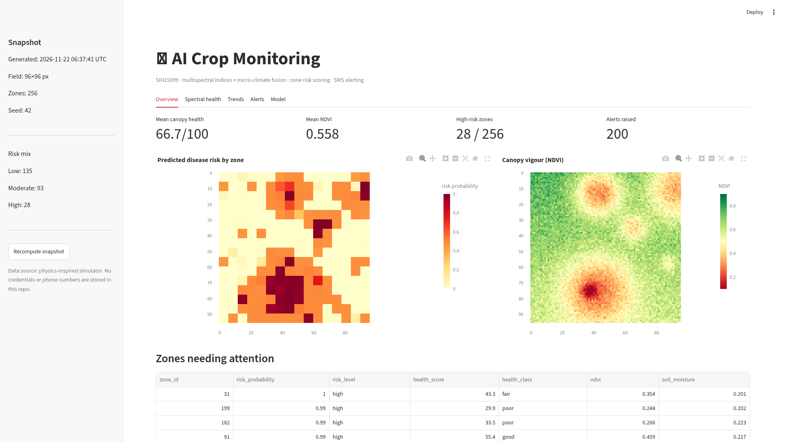
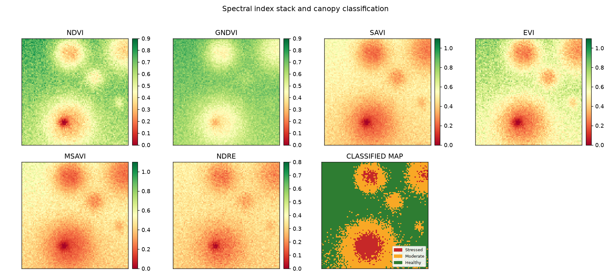
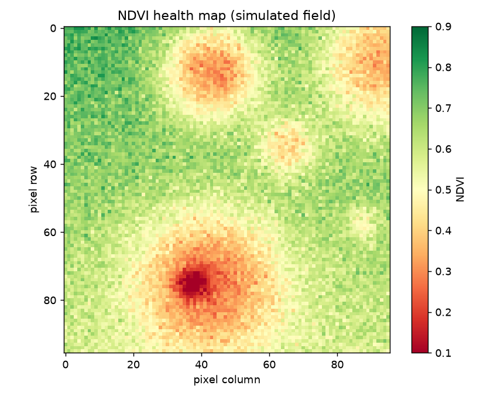
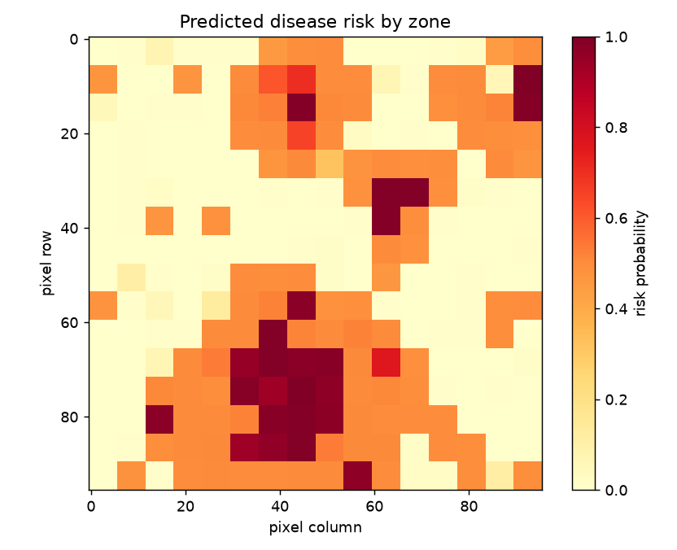
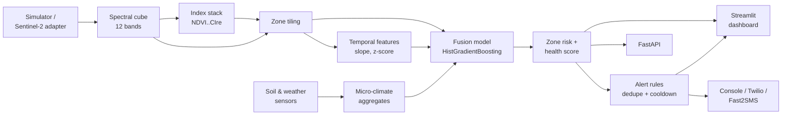
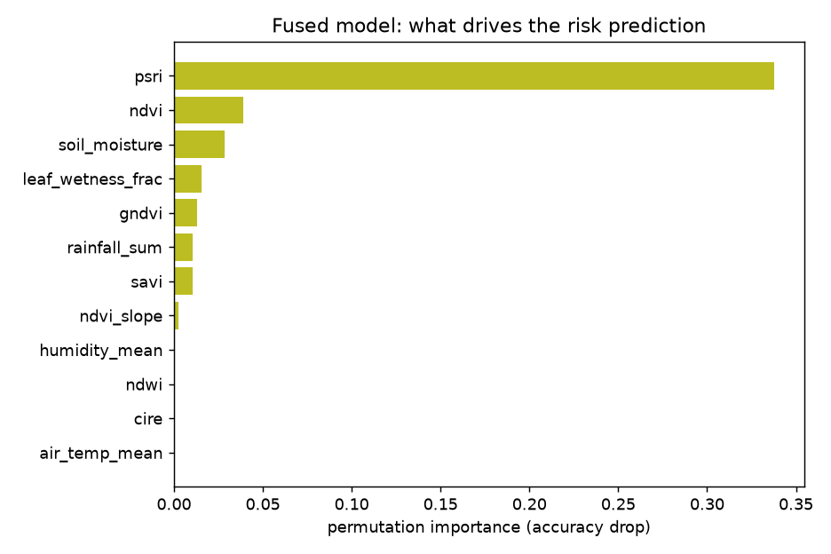
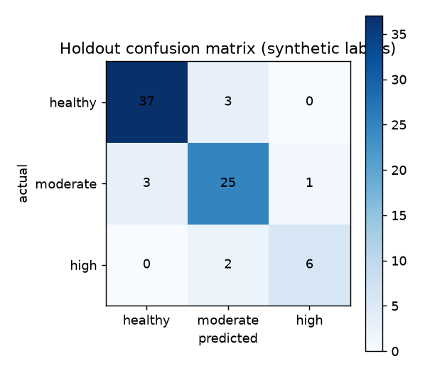

# AI Crop Monitoring

Field-level crop health, soil condition, and pest-risk monitoring from multispectral
imagery fused with micro-climate sensors. Built for Smart India Hackathon 2025 problem
**SIH25099** (MathWorks India): turn delayed, labour-heavy scouting into a ranked,
zone-by-zone action list with SMS alerts.

The repository ships a complete, tested platform that runs end to end with a
physics-inspired simulator, plus adapters for real Sentinel-2/Landsat and sensor feeds.

```bash
pip install -e ".[dev]"
python scripts/run_pipeline.py        # data -> features -> model -> zones -> alerts -> figures
streamlit run dashboard/app.py        # dashboard on :8501
uvicorn cropmon.api.main:app --app-dir src   # REST API on :8000
```







## What it does

| Stage | Module | Output |
| --- | --- | --- |
| Simulate / ingest | `cropmon.data` | 12-band reflectance cube, hourly sensors, weekly zone history |
| Spectral indices | `cropmon.features.indices` | NDVI, GNDVI, NDRE, SAVI, EVI, NDWI, PSRI, CIre |
| Temporal analysis | `cropmon.features.temporal` | Rolling means, least-squares slope, MAD z-scores, anomaly flags |
| Zone analytics | `cropmon.analysis` | Per-zone index statistics, 0-100 health score, disease pressure, water/heat stress |
| Pixel classification | `cropmon.analysis.classification` | Stressed / Moderate / Healthy map, `data/class_summary.csv` |
| Index panel | `cropmon.viz` | Six-index montage plus class map (`docs/figures/index_panel.png`) |
| Fusion model | `cropmon.models.fusion` | Gradient-boosted 3-class risk model + permutation importance |
| Alerting | `cropmon.alerts` | Rule engine with cooldown/dedupe, console/Twilio/Fast2SMS channels, token-bucket rate limit |
| Serving | `dashboard/`, `cropmon.api` | 5-tab Streamlit app, FastAPI endpoints |

The core idea is **fusion**: the same NDVI drop means different things at 92 % humidity
and 22 °C than it does in dry, 35 °C air. Spectral indices supply what the canopy looks
like; sensors supply whether the weather currently favours infection.

## Architecture



Full write-up: [`docs/architecture.md`](docs/architecture.md).
Model card and limitations: [`docs/MODEL_CARD.md`](docs/MODEL_CARD.md).

## Results on the bundled snapshot

Seed 42, 96×96 px field, 256 zones, 14 days of hourly sensors, 12 weeks of history.
Labels carry 8 % scouting noise so the metrics are not perfectly separable.

| Metric | Value |
| --- | --- |
| Holdout accuracy | **0.883** |
| Macro F1 | **0.857** |
| ROC AUC (OvR) | **0.937** |
| Train / test zones | 179 / 77 |
| Mean canopy health | 66.7 / 100 |
| Risk mix | 135 low · 93 moderate · 28 high |
| Pixel classes | 5517 healthy · 3035 moderate · 664 stressed (of 9216 px) |
| Alerts | 200 (28 critical, 154 warning, 18 info) |

Top drivers: PSRI (senescence), NDVI, soil moisture, leaf-wetness fraction, GNDVI.

The classification panel is the corrected version of the original MATLAB montage:
EVI stays inside 0-1.1 instead of -5000..1000, and the class map is not a single
colour. Nine indices are computed (including MSAVI); seven of them feed the model,
because MSAVI is collinear with SAVI on this simulator and adds no signal.




These numbers describe how well the model reproduces the simulator's agronomic risk
model. They are **not** a field-validated accuracy claim — see the model card.

## Quickstart

### 1. Install

```bash
python -m venv .venv
source .venv/bin/activate          # Windows: .venv\Scripts\Activate.ps1
python -m pip install --upgrade pip
pip install -e ".[dev]"
```

Optional extras: `pip install -e ".[deep]"` adds TensorFlow for the hybrid CNN-LSTM
(`cropmon.models.deep`).

### 2. Generate a snapshot

```bash
python scripts/run_pipeline.py          # add --no-figures to skip PNG rendering
python scripts/train_model.py           # retrain and print holdout metrics
python scripts/generate_demo_data.py    # raw CSVs only, no model
```

`data/class_summary.csv` mirrors the MATLAB export (`Class,PixelCount`) so the
pixel-class breakdown can be diffed against the prototype output.

Artifacts land in `artifacts/` (model, metrics, zones, alerts) and `data/` (sensors,
history, spectral maps). Both directories are git-ignored because they are reproducible.

### 3. Explore

```bash
streamlit run dashboard/app.py
```

Tabs: **Overview** (KPIs, risk map, priority zones) · **Spectral health** (index maps
including MSAVI, zone signature, pixel classification) · **Trends** (anomaly-marked NDVI, per-zone trajectories, sensors) ·
**Alerts** (filter, CSV export, SMS delivery) · **Model** (metrics, importance, model card).

The dashboard runs the pipeline automatically on first load if artifacts are missing.

### 4. Serve the API

```bash
uvicorn cropmon.api.main:app --app-dir src --reload
```

```bash
curl -s localhost:8000/predict -H 'content-type: application/json' -d '{
  "zones": [{"ndvi": 0.32, "psri": 0.22, "soil_moisture": 0.14, "humidity_mean": 91}]
}'
# {"predictions":[{"risk_probability":0.93,"risk_level":"high",...}]}
```

| Endpoint | Purpose |
| --- | --- |
| `GET /health` | Liveness plus model accuracy |
| `GET /metadata` | Model metadata, holdout metrics, snapshot summary |
| `POST /predict` | Score 1-1000 zones from any subset of features |
| `GET /zones?risk_level=high&limit=20` | Ranked zone list |
| `GET /alerts?severity=critical` | Alert feed |
| `GET /summary` | Snapshot summary |

Interactive docs at `http://localhost:8000/docs`.

## SMS alerts

Nothing is hardcoded. Credentials and recipients come from the environment; copy
`.env.example` to `.env` (git-ignored) or export the variables.

```bash
export CROPMON_SMS_CHANNEL=twilio
export TWILIO_ACCOUNT_SID=AC...
export TWILIO_AUTH_TOKEN=...
export TWILIO_FROM_NUMBER=+14155550100
export ALERT_RECIPIENT=+14155550123
python scripts/send_alerts.py --severity critical --limit 3 --send
```

`CROPMON_SMS_CHANNEL=console` (the default) prints messages instead of sending, so the
whole flow is testable without an account. Every channel validates E.164 numbers, a
token bucket caps hourly volume, and the alert engine suppresses repeats per
zone/rule for `alert_cooldown_hours`.

## Tests, lint, CI

```bash
python -m pytest -q        # 84 tests
python -m ruff check src dashboard scripts tests
```

Coverage includes index mathematics, temporal features, zone aggregation, dataset
construction, model training/serialisation, alert dedupe and cooldowns, SMS payloads
via `httpx.MockTransport`, the API surface, and a security test that fails if a phone
number or Twilio key is ever committed. GitHub Actions runs lint, tests, and a pipeline
smoke test on Python 3.10 and 3.12.

## Project layout

```
src/cropmon/
  config.py            settings + env overrides
  data/                simulator, dataset builder
  features/            spectral indices, temporal features
  models/              fused GBM, optional hybrid CNN-LSTM
  analysis/            zones, health scoring, agronomic risk
  alerts/              rules engine, SMS channels
  pipeline.py          end-to-end orchestration
  cli.py               cropmon pipeline|train|demo-data|alerts|serve
  api/main.py          FastAPI app
dashboard/app.py       Streamlit dashboard
scripts/               thin CLI wrappers
matlab/                NDVI + CNN/LSTM demos for MATLAB users
tests/                 pytest suite
docs/                  architecture, model card, figures
legacy/                original single-file prototypes (archived)
```

## Data and limitations

* The bundled dataset is **simulated**: a leaf/soil mixing model for reflectance, a
  diurnal weather cycle, and a root-zone water balance. Deterministic under `CROPMON_SEED`.
* To use real data, replace `cropmon.data.synthetic` with an ingest adapter. The rest of
  the pipeline consumes plain arrays and DataFrames, so nothing else changes:
  - Sentinel-2 L2A (10 m) or Landsat Collection 2 for imagery
  - Indian Pines / Pavia University for hyperspectral research
  - field sensors (soil moisture, air temperature, humidity, leaf wetness) over MQTT
* No pest counts, soil texture, or yield calibration yet. Alerts are decision support,
  not a diagnosis: confirm in the field before spraying.
* `requirements.txt` is a convenience mirror; `pyproject.toml` is authoritative.

## License

MIT — see [`LICENSE`](LICENSE).
