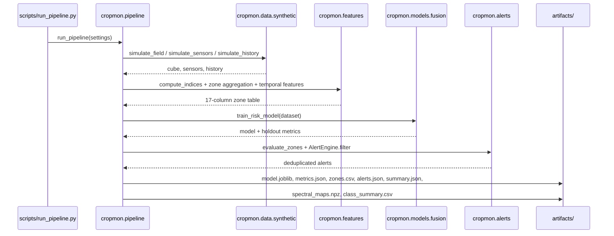

# Architecture

## Request flow

`load_artifacts()` reads the same files back for the dashboard and API, so serving is
read-only and cheap.

## Module responsibilities

| Module | Responsibility | Key entry points |
| --- | --- | --- |
| `cropmon.config` | Immutable settings, env overrides, artifact paths | `Settings`, `Settings.from_env()` |
| `cropmon.data.synthetic` | Deterministic field, weather, and history simulation | `simulate_field`, `simulate_sensors`, `simulate_history` |
| `cropmon.data.dataset` | Fuse indices + climate + trend into one supervised table | `build_zone_dataset`, `FEATURE_COLUMNS` |
| `cropmon.features.indices` | Band-agnostic spectral indices | `compute_indices`, `band_index` |
| `cropmon.features.temporal` | Slope, MAD z-score, EWMA, anomaly masks | `detect_anomalies`, `linear_slope` |
| `cropmon.analysis.zones` | Tiling, per-zone statistics, health score | `zone_map`, `summarise_map`, `health_score` |
| `cropmon.analysis.risk` | Agronomic primitives | `disease_pressure`, `water_stress`, `heat_stress` |
| `cropmon.analysis.classification` | Pixel classes and their counts | `classify_canopy`, `class_counts` |
| `cropmon.viz` | Multi-panel figures | `index_panel` |
| `cropmon.models.fusion` | Train/persist/score the risk model | `RiskModel`, `train_risk_model` |
| `cropmon.models.deep` | Optional hybrid CNN-LSTM (TensorFlow) | `build_hybrid_cnn_lstm` |
| `cropmon.alerts.rules` | Rule evaluation, severity, dedupe, cooldown | `evaluate_zones`, `AlertEngine` |
| `cropmon.alerts.channels` | Delivery adapters and rate limiting | `build_channel`, `RateLimiter` |
| `cropmon.pipeline` | Orchestration and artifact I/O | `run_pipeline`, `load_artifacts` |
| `cropmon.api.main` | HTTP surface | `create_app`, `/predict`, `/zones`, `/alerts` |

## Feature schema

17 features, all numeric, no missing values after `build_zone_dataset`:

* **Spectral (7)** `ndvi`, `gndvi`, `ndre`, `savi`, `ndwi`, `psri`, `cire` — zone means.
  MSAVI is also computed and plotted, but excluded from the model: on this simulator
  it is collinear with SAVI and measured permutation importance was 0.000.
* **Temporal (3)** `ndvi_slope`, `ndvi_change`, `ndvi_z` — weekly trajectory per zone.
* **Climate (7)** `air_temp_mean`, `air_temp_max`, `humidity_mean`, `leaf_wetness_frac`,
  `rainfall_sum`, `soil_moisture`, `vpd_mean` — 7-day aggregates with per-zone microclimate offsets.

## Design decisions

**Why gradient boosting, not a deep net, for the default path?** The fused input is
17 tabular features for a few hundred zones. A GBM trains in under a second, is
deterministic, tolerates missing features, and gives permutation importance that an
agronomist can read. The CNN-LSTM exists for raw cubes and is opt-in.

**Why zone-level rather than pixel-level alerts?** Sprayers, scouts, and irrigation
valves operate on management zones. Pixel maps are for diagnosis; zones are for action.

**Why simulator-first?** It keeps the repository runnable in CI and on a laptop without
private imagery, and it forces the interfaces (arrays in, DataFrames out) that a real
ingest adapter must satisfy.

**Why cooldowns in the alert engine?** A field can produce hundreds of zone-rule pairs
per snapshot. Without dedupe and a cooldown, a single humid night becomes 200 SMS.

## Failure modes and handling

| Failure | Behaviour |
| --- | --- |
| Artifacts missing | Dashboard runs the pipeline; API returns `status: degraded` on `/health` |
| Unknown SMS channel | `ValueError` with the valid options |
| Missing credentials | `ChannelNotConfigured`, surfaced in the UI instead of a silent no-op |
| Invalid phone number | `ValueError` from E.164 validation |
| Rate limit exceeded | `NotificationResult(ok=False, detail="rate limit exceeded")` |
| Cube band count mismatch | `ValueError` from `compute_indices` |
| All-zero reflectance | Index returns `NaN` rather than dividing by zero |
| Nodata pixels in classification | Masked as `-1`, excluded from `class_counts` |
| Digital numbers instead of reflectance | `matlab/index_panel.m` rescales by 10000 before computing indices |
